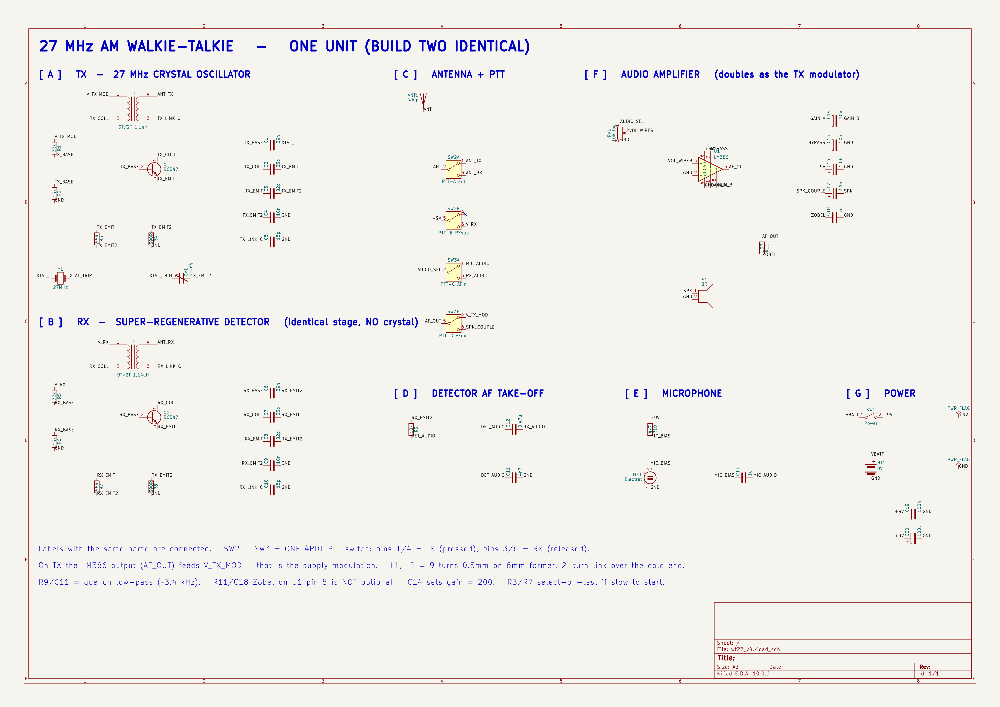
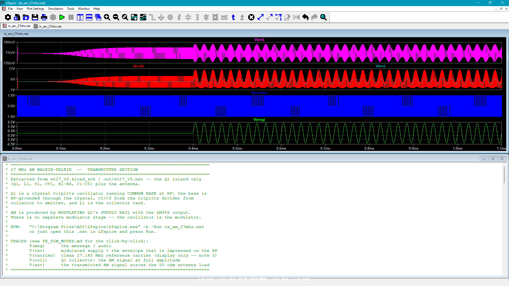
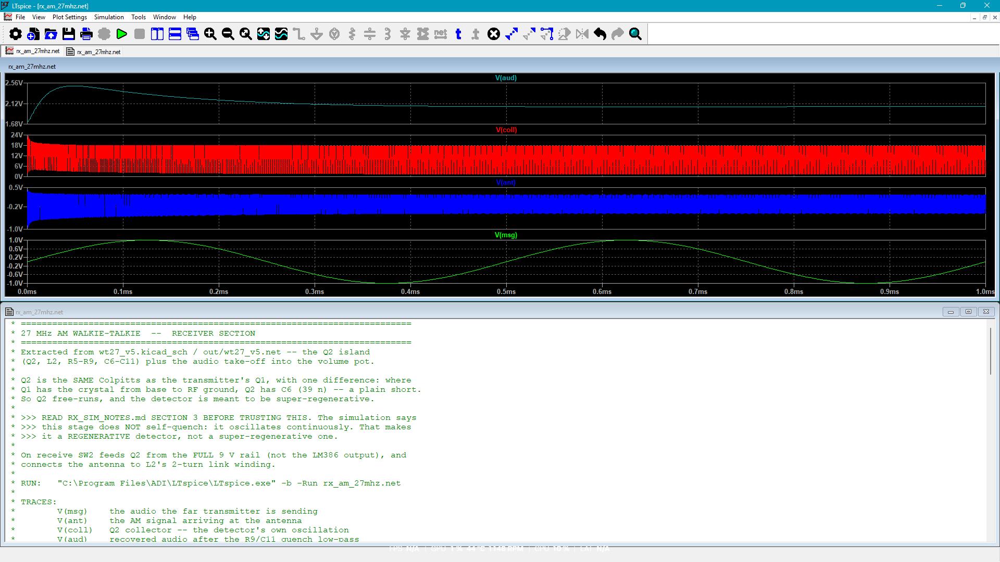
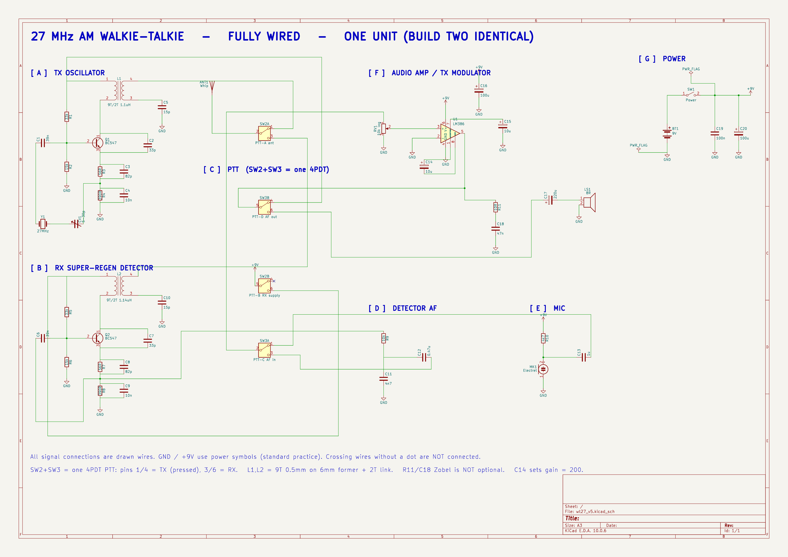

# 📻 27 MHz Fully Analog AM Walkie-Talkie (wt27_v5)

> A pair of **27 MHz AM handheld radios** designed end-to-end in **KiCad**, verified in **LTspice**, and documented for a veroboard build — with **no microcontroller and no RF module**. The RF, modulation, detection, and audio path are all discrete / linear analog.
>
> 📄 **One-page summary:** [`REPORT.md`](REPORT.md)

---

### 🧩 Block schematic



### 📡 TX simulation 

Crystal Colpitts with LM386 supply AM — carrier ~27.15 MHz, modulation index ≈ 0.5.



### 🔍 RX simulation 

Intended super-regen — collector oscillates continuously; recovered audio ignores the antenna (see quench mod).



---

## 👥 Authors

Team project — Ahsanullah University of Science and Technology (AUST), Dhaka  
**Communication Engineering Lab · EEE 3208** · KiCad 10 · LTspice 26 · [MIT License](LICENSE)

| | |
|---|---|
| **Repo** | [github.com/maheen-ahmed1/analog-walkie-talkie](https://github.com/maheen-ahmed1/analog-walkie-talkie) |
| **Authors** | Sarkar Maheen Ahmed, Azmain Muksit, Amir Hamza Talib, Nahinul Islam Prottoy,Lion Ahmmed Fahim |

---

> 💡 This repository is the design deliverable. **The radios were never assembled in hardware** — critical RF parts (notably crystals, PTT switches, and market-specific passives) could not be obtained reliably in time. That constraint pushed the work deeper into simulation: every transmitter passive was swept ±30 % in LTspice, which produced [`PARTS_TOLERANCE.md`](PARTS_TOLERANCE.md), and the receiver failure mode was characterised before any solder was applied.

| | |
|---|---|
| **Constraint** | Fully analog — no MCU, no nRF/Si4432/etc. module, no digital PLL |
| **Band / mode** | 27 MHz AM (crystal-controlled TX) |
| **Supply** | 9 V battery |
| **TX** | BC547 crystal Colpitts; AM by modulating Q1’s supply from the LM386 |
| **RX** | Super-regenerative detector (BC547) + designed NE555 external quench |
| **Audio** | LM386 (gain 200), electret mic, speaker |
| **Switching** | 4-pole PTT (antenna, RX rail, audio source, LM386 destination) |
| **CAD / sim** | KiCad 10 · LTspice 26 |
| **Hardware** | Not built — blocked by parts availability |

---

## 🎯 Purpose and design brief

The educational goal was to understand a real radio chain, not to wrap a ready made transceiver IC:

1. Generate a stable 27 MHz carrier with a crystal oscillator.
2. Impose AM without a modulation transformer.
3. Recover the message with an analog detector.
4. Share one audio amp (LM386) between mic→TX and RX→speaker via PTT.
5. Keep the parts list buildable from local Bangladesh stores where possible.

Everything in this repo — schematic, netlist, BOM, tolerance study, TX/RX sims, and quench modification — exists to show that chain was designed and stress-tested in simulation even though the boards never left the CAD/sim stage.

---

## 📐 Architecture overview

Four RF/audio blocks share one **LM386** and one **4-pole PTT**. Receive and transmit are two wirings of the same board — not two separate radios.

### ⚡ Signal flow

```text
 RECEIVE (PTT released)
   antenna ──► L2 ──► Q2 detector ──► R9/C11 ──► RV1 ──► LM386 ──► speaker

 TRANSMIT (PTT pressed)
   mic ──► C13 ──► RV1 ──► LM386 ──► Q1 VCC (AM) ──► Colpitts + Y1 ──► L1 ──► antenna
```

> On TX, the LM386 output *is* Q1’s supply rail. Voice amplitude scales RF swing — that is the AM; there is no separate modulator or audio transformer.

### 🗂️ Functional blocks

| Block | Parts | Role |
|---|---|---|
| **TX** | Q1 (BC547), Y1, CV1, L1, R1–R4, C1–C5 | Crystal Colpitts @ ~27 MHz; supply-modulated AM |
| **RX** | Q2 (BC547), L2, R5–R9, C6–C11 | Super-regen detector (+ optional NE555 quench) |
| **Audio** | U1 LM386, RV1, C14–C18, R11 | Gain 200 — speaker on RX, modulator on TX |
| **Mic** | MK1, R10, C13 | Electret capsule |
| **PTT** | SW2 + SW3 (4PDT) | Antenna, RX power, AF source, LM386 destination |
| **Power** | BT1, SW1, C16, C19, C20 | 9 V + switch + decoupling |

### 🎚️ PTT switching (4 poles)

| Pole | Common | Released → **RX** | Pressed → **TX** |
|---|---|---|---|
| SW2-A | Antenna | L2 (detector) | L1 (transmitter) |
| SW2-B | +9 V | RX supply on | RX supply off |
| SW3-A | RV1 input | Detector audio (C12) | Microphone (C13) |
| SW3-B | LM386 output | Speaker (C17) | Q1 supply (TX AM) |

### 🔌 Fully wired schematic

Block diagram above (hero) groups the circuit by function. The wired view below is the **same netlist** — every connection drawn, GND / +9 V explicit, **34 nets**.



| | |
|---|---|
| **TX result** | `fosc` = 27.1500 MHz, AM index ≈ 0.497 → [`sim/TX_SIM_NOTES.md`](./sim/TX_SIM_NOTES.md) |
| **RX result** | No self-quench in sim → [`sim/RX_SIM_NOTES.md`](./sim/RX_SIM_NOTES.md) · fix → [`QUENCH_MOD.md`](./QUENCH_MOD.md) |
| **PDF** | [`wt27_BLOCKS.pdf`](./out/wt27_BLOCKS.pdf) · [`wt27_WIRED.pdf`](./out/wt27_WIRED.pdf) |
| **Build** | Staged veroboard procedure → [`BUILD.md`](./BUILD.md) |

---

## ⚙️ Receiver topology: super-regen chosen for simplicity

| | Super-regenerative  | Superheterodyne  |
|---|---|---|
| Why pick it | Fewer parts, ~2 tuned circuits, no IF cans | Selectivity, stability, predictable behaviour |
| Complexity | Lower | Higher — mixer, LO, IF transformers, ~7 alignments |
| Reliability | Lower — depends on quench working correctly | Higher — mass-produced sets use this |
| Local parts | BC547 + hand-wound L2 | 455 kHz IF transformers hard to source here |

**We chose super-regen to keep the build less complex** — buildable from discrete transistors and hand-wound coils, without hunting for IF transformers. That choice buys simplicity, not reliability: a super-regen only works if the detector actually quenches and restarts. Classic self-quenching bias often fails that test (our LTspice run showed continuous oscillation and zero sensitivity — [`sim/RX_SIM_NOTES.md`](sim/RX_SIM_NOTES.md)).

**Mitigation if hardware misbehaves:** the **quench-mod approach** ([`QUENCH_MOD.md`](QUENCH_MOD.md)) — an NE555 that forcibly chops Q2’s supply. That was the planned recovery path if the detector did not self-quench on the bench. Simulation already said it would not; the mod restores message recovery in sim. Because parts never arrived, the bench confirmation never happened, but the fix is fully designed and costed.

**If a more reliable RX is required**, the next step is a **superheterodyne** front-end (mixer + LO + IF), as in certified sets such as FCC ID [AAO2101614](https://fccid.io/AAO2101614). That path is more complex and needs IF parts, but it is the right answer when selectivity and day-to-day reliability matter more than a minimal discrete BOM.

*(An earlier `tx_rx_v1.0` attempt followed a superhet brief; this repo is the discrete super-regen design that replaced it under the complexity constraint.)*

---

## 📊 Outcomes

### 🔹 1. Fully analog AM without a transformer

Classic toy walkie-talkies use an audio transformer and often a speaker-as-microphone. Both are failure-prone. We replaced that path with an **electret + LM386**, and used the LM386 output as the **TX supply** so amplitude modulation falls out of the oscillator physics. Sim confirmed near-linear envelope ratio ≈ 2.98 vs theoretical 3.00 at *m* = 0.5.

### 🔹 2. Separate TX and RX RF transistors

Many cloned “4-transistor” 27 MHz circuits share one stage and pull the crystal for receive. That shared stage is a documented reason those builds perform poorly. We kept **Q1 (TX)** and **Q2 (RX)** independent and let the 4PDT PTT do the mode change.

### 🔹 3. Parts were unavailable → simulate tolerances instead of guessing

Because the build never reached a bench, we could not “trim until it works.” Instead every TX passive was swept at **−30 % / nominal / +30 %** in LTspice. Results are written up in [`PARTS_TOLERANCE.md`](PARTS_TOLERANCE.md):

- Carrier stays inside **27.117–27.146 MHz** across all those sweeps — the crystal owns the frequency; resistor trimming is mostly theatre.
- Only **C2 (33 pF)** and **L1 (~1.1 µH)** can kill the oscillator when high (tank pulled below the crystal).
- Putting trimmer pots in RF positions (especially R3 across the Colpitts divider) is worse than a fixed ±5 % resistor.

That document is the student answer to “our market parts are not 1 % precision — will it still work?”

### 🔹 4. The receiver does not self-quench (sim finding)

A super-regen needs the RF oscillation to **die and restart** at ~20–50 kHz. In simulation, Q2 ran as a continuous ~16 Vpp oscillator (`quench_test` ≈ 1.00). Audio at R9/C11 was identical for **10 µV and 50 mV** antenna input — i.e. no message recovery. Bias sweeps (L2, C9, base network, R7, supply) confirmed the stage has nothing that switches it off ([`sim/RX_SIM_NOTES.md`](sim/RX_SIM_NOTES.md)).

### 🔹 5. Quench mod — the reliability patch for a simple RX

Super-regen is less complex but also less reliable. Once sim showed Q2 never self-quenches, we treated an **external quench** as the fallback if (when) hardware behaved the same way: a **NE555 astable** chopping Q2’s supply (~30 kHz, **50 % duty** — diode required; a plain 555’s ~67 % duty was nearly deaf). With that quench, recovered audio became **monotonic with antenna level** down to 10 µV ([`QUENCH_MOD.md`](QUENCH_MOD.md)). Documented and costed (~৳40 for both units); not merged into the main schematic because the build never reached the bench. Anyone who needs a more reliable receiver long-term should move to **superhet**, not keep patching quench.

### 🔹 6. Build process written as if the parts existed

[`BUILD.md`](BUILD.md) is a full staged veroboard manual (power → audio → crystal jig → RX → quench → TX → PTT → second unit → range). [`BOM.md`](BOM.md) / [`BOM.csv`](BOM.csv) map every designator to local store links. Those files remain the path to a future hardware build.

---

## 📌 Project status

| Area | Status |
|---|---|
| Schematic (KiCad) | Complete — ERC 0 / 0 |
| TX LTspice | Pass — ~27.15 MHz, *m* ≈ 0.5 |
| RX LTspice | Pass - but might fail without quench in hardware|
| Quench mod | Designed & sim-verified; not merged into main schematic |
| Part tolerance study | Done from TX ±30 % sweeps → `PARTS_TOLERANCE.md` |
| Physical build | **Not started** — blocked by parts availability |
| PCB fab | Dropped; target was veroboard |

---

## 📁 Repository layout

```text
wt27_v5/
├── wt27_v5.kicad_pro / .kicad_sch / .kicad_pcb
├── README.md                 # Overview + hero figures
├── REPORT.md                 # One-page design report
├── LICENSE                   # MIT
├── BUILD.md                  # Veroboard build & debug manual
├── BOM.md / BOM.csv / BOM.pdf
├── PARTS_TOLERANCE.md        # LTspice ±30 % sweeps
├── QUENCH_MOD.md             # NE555 external quench
├── out/                      # Schematic PDFs/PNGs + netlist
└── sim/                      # LTspice nets, notes, tx_sim.png / rx_sim.png
```

---

## 🧭 How to explore the design

1. **Report** — [`REPORT.md`](REPORT.md) for a short walkthrough.  
2. **Schematic** — open `wt27_v5.kicad_pro` in KiCad 10, or read the PDFs/PNGs in `out/`.  
3. **TX sim** — `sim/tx_am_27mhz.net` → [`sim/TX_SIM_NOTES.md`](sim/TX_SIM_NOTES.md).  
4. **RX sim** — `sim/rx_am_27mhz.net` → [`sim/RX_SIM_NOTES.md`](sim/RX_SIM_NOTES.md).  
5. **Tolerance** — [`PARTS_TOLERANCE.md`](PARTS_TOLERANCE.md).  
6. **If building later** — [`BOM.md`](BOM.md) then [`BUILD.md`](BUILD.md); quench per [`QUENCH_MOD.md`](QUENCH_MOD.md) if needed.

---

## ⚡ Key technical parameters 

| Parameter | Result |
|---|---|
| TX carrier `fosc` | 27.1500 MHz |
| TX AM depth `mod_depth` | 0.497 (target 0.5) |
| Antenna load swing (sim) | ~0.276 Vpp into 50 Ω |
| Crystal netting (CV1) | ~12–30 pF moves carrier ~7 kHz |
| Critical TX parts | C2, L1 (tank must not sit below crystal) |
| RX without quench | Continuous oscillation; no input sensitivity |
| Quench (designed) | ~30 kHz, 50 % duty, supply chop on Q2 |

---

## 🛠️ Skills

> KiCad schematic / ERC · LTspice RF transient analysis · crystal Colpitts · AM supply modulation · super-regen vs superhet trade-offs · parts tolerance from simulation · BOM sourcing · technical documentation of failures and fixes

---

## 📜 License / RF note

> ⚖️ Source and docs are under the [MIT License](LICENSE). Transmitting on 27 MHz is regulated — check local rules for power, antenna, and licensing before any on-air test.

---

## 🗺️ Document map

| Topic | File |
|---|---|
| Portfolio report | [`REPORT.md`](REPORT.md) |
| Build procedure | [`BUILD.md`](BUILD.md) |
| Shopping list | [`BOM.md`](BOM.md) |
| Market-part accuracy | [`PARTS_TOLERANCE.md`](PARTS_TOLERANCE.md) |
| TX simulation | [`sim/TX_SIM_NOTES.md`](sim/TX_SIM_NOTES.md) |
| RX failure analysis | [`sim/RX_SIM_NOTES.md`](sim/RX_SIM_NOTES.md) |
| Quench fix | [`QUENCH_MOD.md`](QUENCH_MOD.md) |
